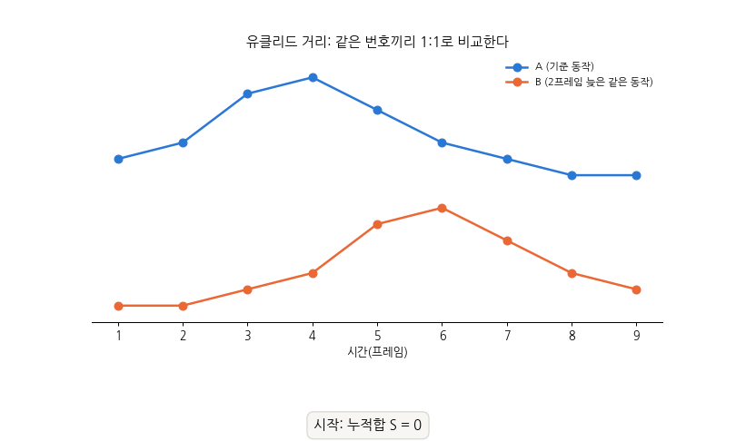
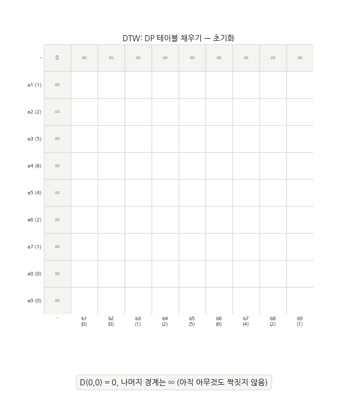
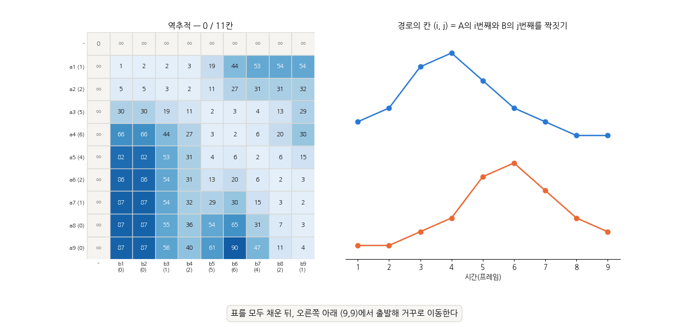
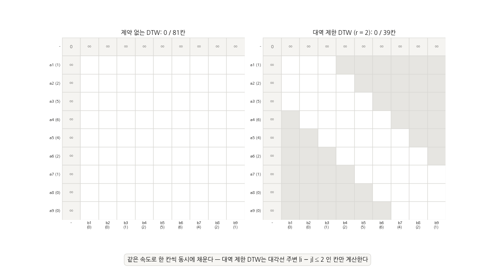

# 유클리드 거리 vs DTW vs 대역 제한 DTW — 알고리즘 동작 시각화

2026년 2학기 알고리즘 과제의 보조 자료입니다. 두 시계열이 얼마나 비슷한지 계산하는 세 가지 방법이 내부에서 어떻게 동작하는지 GIF로 보여줍니다.

- **A** = [1, 2, 5, 6, 4, 2, 1, 0, 0] — 기준 동작
- **B** = [0, 0, 1, 2, 5, 6, 4, 2, 1] — A와 같은 동작인데 2프레임 늦게 시작

| 노트북 | 내용 | Colab에서 열기 |
|---|---|---|
| `dtw_gif_animation.ipynb` | 아래 GIF 4개를 만드는 코드 | [](https://colab.research.google.com/github/dayoung0652/dtw-visualization/blob/main/dtw_gif_animation.ipynb) |
| `dtw_report_figures.ipynb` | 보고서 그림 1~15를 만드는 코드 | [](https://colab.research.google.com/github/YOUR_ID/dtw-visualization/blob/main/dtw_report_figures.ipynb) |

Colab에서 연 뒤 **런타임 → 모두 실행**을 누르면 그대로 실행됩니다.

---

## ① 유클리드 거리 — 선형 탐색



같은 번호의 점끼리만 1:1로 비교하며 차이의 제곱을 누적합니다. 9번 비교로 끝나지만(O(n)), B가 2프레임 늦게 시작했다는 것을 알 수 없어 거리가 √68 = 8.25로 크게 나옵니다.

## ② DTW — DP 테이블 채우기



각 칸 D(i, j)를 `비용 (a[i] − b[j])² + min(↖, ↑, ←)`으로 왼쪽 위부터 한 칸씩 채웁니다. 노란 화살표는 지금 칸이 참조하는 세 이웃입니다. 81칸(O(n²))을 모두 채우면 오른쪽 아래 D(9,9) = 4, DTW 거리는 √4 = 2.00입니다.

## ③ DTW — 역추적으로 워핑 경로 찾기



(9,9)에서 출발해 ↖, ↑, ← 중 값이 가장 작은 칸으로 거꾸로 이동합니다. 오른쪽 그림에서 경로의 각 칸이 실제로 어떤 점끼리의 짝인지 보여줍니다. 봉우리 a4와 b6처럼 모양이 같은 점끼리 짝지어집니다.

## ④ 제약 없는 DTW vs 대역 제한 DTW (사코-치바 밴드, r = 2)



두 표를 같은 속도로 동시에 채웁니다. 대역 제한 DTW는 대각선 주변 |i − j| ≤ 2 인 칸만 계산하므로(회색 칸은 계산하지 않음) 39칸 만에 끝나고, 81칸을 모두 계산한 제약 없는 DTW와 같은 거리 2.00을 얻습니다.

---

## 파일 구성

```
dtw-visualization/
├── README.md
├── dtw_gif_animation.ipynb     # GIF 4개 생성
├── dtw_report_figures.ipynb    # 보고서 그림 1~15 생성
└── gifs/
    ├── gif1_euclidean.gif
    ├── gif2_dtw_fill.gif
    ├── gif3_backtrack.gif
    └── gif4_full_vs_band.gif
```
